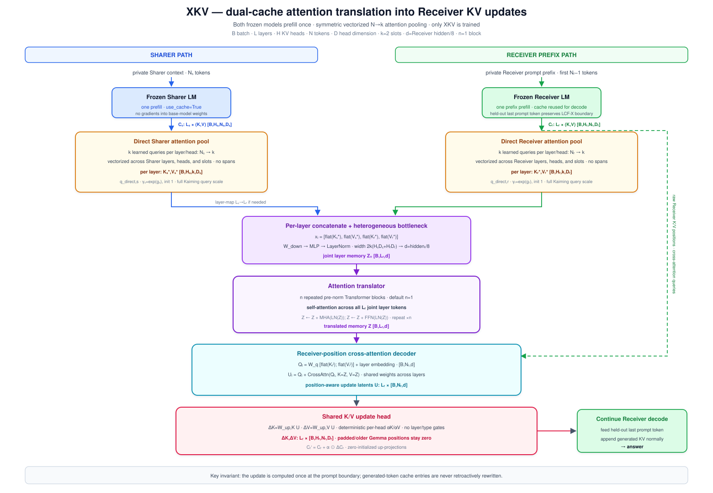

# XKV: Dual-Cache Attention Translator — Architecture and Implementation Plan

## 1. Objective

XKV is a Sharer-to-Receiver communication method that reads the **KV caches of
both models** and predicts a **Receiver-native KV-cache update**. It combines
three ideas:

1. reuse LCF-X's position-free, two-stage attention pooling on both caches;
2. translate the resulting joint representation with attention; and
3. reuse LCF-X's gated residual-update semantics at the output.

Both language models remain frozen. Only the XKV pools, bottleneck, translator,
and update head are trained.



## 2. Notation and cache boundary

- `B`: batch size.
- `L_s`, `L_r`: Sharer and Receiver layer counts.
- `H_s`, `H_r`: Sharer and Receiver KV-head counts.
- `D_s`, `D_r`: Sharer and Receiver head dimensions.
- `N_s^l`, `N_r^l`: real per-layer Sharer and Receiver cache lengths. These are
  normally constant over layers; Gemma-3 mixes sliding and full attention, so
  they may differ.
- `P_s`, `P_r`: numbers of spans used by the LCF-X pools.
- `Q`: retained cross-span summaries per layer and side (`Q=2` by default).
- `d`: XKV bottleneck/translator width (default: Receiver hidden width divided
  by 8).

The frozen Sharer prefills its context and produces
`C_s = {(K_s^l,V_s^l)}_(l=1..L_s)`. The frozen Receiver prefills **all but the
last prompt token** and produces
`C_r = {(K_r^l,V_r^l)}_(l=1..L_r)`. XKV reads both caches once, emits a residual
`Delta C_r`, adds it to that Receiver prefix cache, and then normal decoding
continues with the held-out last prompt token. This is the same cache boundary
used by `LCFXPair.decode_receiver`, preserving causal decoding and the
zero-update equivalence check.

## 3. Architecture

### 3.1 Dual LCF-X pooling

Apply independent copies of the existing LCF-X two-stage pool to the two raw
caches. The copies do not share queries because their KV geometries and roles
differ.

For side `a in {s,r}` and layer `l`:

1. **Within-span attention:** learned `q_base,a^l` pools the real token positions
   in every span, `N_a -> P_a`.
2. **Cross-span attention:** `Q` independent learned queries
   `q_layer,a^(l,j)` pool the `P_a` span summaries to `Q` summaries,
   `P_a -> Q` (default `Q=2`).

This yields `(K_a*^l,V_a*^l)` with shape `[B,H_a,Q,D_a]`. Each query has its
own parameters, so the two default slots can retain different information;
they are not copies or broadcasts of one pooled value. Padding is excluded
with per-example lengths. Natural paragraph boundaries should be supported in
addition to fixed, near-equal token spans.

For Gemma-3 only, define `N_a* = min_l N_a^l` and pool the most recent `N_a*`
positions from every layer. Crop the mask to the same suffix and shift natural
span boundaries by the number of discarded real tokens. Non-Gemma caches keep
the strict requirement that every layer has the same width.

### 3.2 Layer alignment, concatenation, and bottleneck

Map the Sharer layer axis to `L_r` when `L_s != L_r`, using the same linear
layer-axis bridge as LCF-X. For each Receiver layer `l`, flatten heads and K/V,
then concatenate the two pooled sides:

```text
x_l = [flat(K_s*^l), flat(V_s*^l), flat(K_r*^l), flat(V_r*^l)]
      in R^(2 Q H_s D_s + 2 Q H_r D_r)
      = R^(Q * (2 H_s D_s + 2 H_r D_r))

z_l = LN(MLP(W_down x_l)) in R^d
```

The result `Z=[z_1,...,z_Lr]` has shape `[B,L_r,d]`. `W_down` is the explicit
heterogeneous-model bridge; XKV must not require matching layer, head, head-dim,
sequence, or tokenizer geometry.

The fixed concatenation order preserves side identity; optionally apply
side-specific normalization before concatenation to balance cache scales. Add a
learned Receiver-layer embedding to `z_l` before attention so the translator
does not treat the layer tokens as an unordered set.

### 3.3 Attention translator

Process `Z` with a stack of `n` pre-norm Transformer encoder blocks. Use
`n=1` by default and expose it as `--num-attention-blocks`. Each block has its
own parameters unless an explicit weight-tied recurrent ablation is selected:

```text
Z <- Z + MHA(LN(Z), LN(Z), LN(Z))
Z <- Z + FFN(LN(Z))
```

Repeat this update `n` times. Self-attention lets every Receiver-layer update
use evidence from all pooled Sharer and Receiver layers instead of assuming a
strict `l -> l` relationship. Use a padding mask only if a future variant
supports a variable number of layer tokens; sequence padding has already
disappeared in the pooling stage.

### 3.4 Receiver-position cross-attention decoder and KV head

Full pooling removes token positions, so recover position-specific updates by
using the raw Receiver cache as queries into the translated layer memory:

```text
Q_l = W_q [flat(K_r^l); flat(V_r^l)] + e_l  # [B,N_r,d]
U_l = Q_l + CrossAttn(LN(Q_l), K=Z, V=Z)
U_l = U_l + FFN(LN(U_l))
alpha_K, alpha_V = sigmoid(W_gate U_l)       # per Receiver KV head
Delta_K = reshape(W_up,K U_l)                # [B,H_r,N_r,D_r]
Delta_V = reshape(W_up,V U_l)                # [B,H_r,N_r,D_r]
g_K, g_V = layer/type Gumbel-sigmoid gates

K_r' = K_r + g_K * alpha_K * Delta_K
V_r' = V_r + g_V * alpha_V * Delta_V
```

Use separate `W_up,K` and `W_up,V`, but **share both projections and
`W_gate` across Receiver layers**. The query projection, cross-attention, and
decoder FFN are shared as well; learned Receiver-layer embeddings and
`g_K^l,g_V^l` retain layer identity. For Gemma-3, decode the recent common
window and left-pad full-attention layers with zeros so older cache positions
are preserved. Padding positions also receive zero updates.

During training, anneal the layer/type gates from soft Gumbel-sigmoid
(`tau: 1.0 -> 0.5`); at evaluation use hard `{0,1}` gates, matching LCF-X.
Zero-initialize the two up-projections so an untrained XKV produces exactly zero
residual and therefore reproduces Receiver-only decoding.

## 4. End-to-end execution

1. Tokenize the two private contexts independently.
2. Run frozen Sharer prefill under `no_grad`; retain raw `C_s`.
3. Run frozen Receiver prefix prefill under `no_grad`; retain raw `C_r`.
4. Pool `C_s` and `C_r` independently with the two-stage LCF-X pools.
5. Align the layer axes, concatenate the pooled side features, and bottleneck to
   `[B,L_r,d]`.
6. Run self-attention translation over the joint layer memory.
7. Use raw Receiver K/V positions as queries in the shared cross-attention
   decoder, then generate position-specific `(Delta K, Delta V)` through the
   two shared full-width up-projections.
8. Add the gated residual to `C_r`.
9. Feed the held-out last Receiver prompt token, then decode autoregressively.

The update is computed once at the prompt boundary. Generated-token KV entries
are appended normally and are not repeatedly rewritten. A recurrent/recomputed
update can be studied later, but it should not be part of the MVP because it
changes latency, causality, and the comparison with LCF-X.

## 5. Training objective

- Freeze the Sharer and Receiver parameters; put both models in evaluation mode.
- Optimize only XKV with teacher-forced next-token cross-entropy on the gold
  Receiver answer.
- Produce the two prefix caches under `no_grad` and detach them. Apply the XKV
  residual, then run the frozen Receiver over the answer with gradients enabled
  through the cache values. Frozen Receiver weights need no optimizer state, but
  the forward graph must remain differentiable with respect to `Delta C_r`.
- Mask prompt and padding labels; supervise answer tokens plus the resolved stop
  token, following the existing LCF-X training path.
- Use AdamW, gradient clipping, mixed precision, validation loss for checkpoint
  selection, and the same effective-batch protocol as the baselines.
- Regularize update magnitude with a small optional term
  `lambda_delta * mean(||Delta K||_2 + ||Delta V||_2)` and log per-layer update
  RMS/gate activity. Start with `lambda_delta=0`; enable it only if update norms
  become unstable.

## 6. Proposed repository layout

Create an independent `methods/xkv/` package, mirroring `methods/lcfx/` rather
than coupling the two methods through inheritance:

| File | Responsibility |
|---|---|
| `pool.py` | Reusable two-stage pool for one cache side; accepts lengths and span boundaries. |
| `translator.py` | Dual pools, layer bridge, joint bottleneck, self-attention translator, Receiver-position cross-attention decoder, and shared KV update head. |
| `cache.py` | Reuse or wrap `extract_kv` and `add_residual_inplace`; validate layer/shape/dtype/device invariants. |
| `model.py` | Frozen pair loading and Receiver prefix-cache decode boundary. |
| `training.py` | Batched loss, evaluation, checkpoint save/load, gate-temperature schedule, and training loop. |
| `runner.py` | One-example/batched inference and standardized timing/result records. |
| `schema.py` | Alias the common cross-context example schema. |
| `__init__.py` | Public exports. |

Add `scripts/train_xkv.py`, `scripts/run_xkv.py`, Makefile targets
`xkv-train`/`xkv-eval`/`xkv`, and model-stamped checkpoints under
`data/checkpoints/xkv/<dataset>/<sharer>/<receiver>/<architecture>/translator.pt`.
The architecture stamp must include all cache geometry, `d`, attention heads,
`n`, `Q`, whether the blocks/heads are shared, span schemes/counts, and gate
configuration.

## 7. Implementation phases

### Phase A — shape-safe MVP

1. Extract and batch both caches, with correct real lengths.
2. Factor the LCF-X two-stage pooling algorithm into an XKV-local two-sided
   module and verify `Q=1` parity against `LCFXFuser.align` on the Sharer path.
3. Implement layer alignment, concatenation, bottleneck, translator blocks,
   position cross-attention decoder, and zero-initialized shared update head.
4. Integrate the Receiver prefix-cache injection/decode path.

### Phase B — training and checkpointing

1. Implement single-example loss, then batched loss with length masking.
2. Add frozen-model training, evaluation, logging, checkpoint metadata, and
   mismatch guards.
3. Add CLI and Makefile integration using the common result contract.

### Phase C — evaluation and ablation

Compare XKV with Receiver-only, T2T, LCF-X, EIYW, KVTok, and the full-context
upper bound. Report EM/F1, trainable parameters, communication size, peak memory,
prefill/translator/decode latency, time to first token, and update RMS.

Required ablations:

- Sharer-only pool versus dual-cache pool;
- concatenation+MLP versus attention translator;
- shared versus per-layer update decoder;
- shared position MLP versus position cross-attention;
- split K/V latents versus full-latent up-projections;
- soft gates versus hard-at-eval gates;
- Stage 1 span tokens retained versus full two-stage summaries;
- one versus two cross-span summaries (`Q=1,2`);
- bottleneck width, translator depth, and span count/scheme.

## 8. Verification gates

1. **Shape matrix:** test homogeneous and heterogeneous pairs, including
   `L_s != L_r`, `H_s != H_r`, `D_s != D_r`, unequal sequence lengths, and
   batch rows with different real lengths. Include Gemma-3 hybrid caches with
   unequal sliding/full layer widths on either side.
2. **Pool correctness:** padded tokens receive zero attention; fixed and natural
   span schemes produce finite summaries; the full-pooling output contains `Q`
   independently queried summaries per layer and side.
3. **Zero-update equivalence:** zero-init XKV logits and greedy output match the
   Receiver-only cache path within dtype tolerance.
4. **Gradient isolation:** finite nonzero gradients reach both pools, bottleneck,
   attention blocks, gates, and up-projections; no base-model
   parameter receives a gradient or optimizer state.
5. **Cache safety:** updates exactly match every Receiver cache layer's
   shape/dtype/device and never alter the Sharer cache.
6. **Single/batched parity:** per-example loss and predictions agree between
   single and padded batched execution.
7. **Checkpoint guards:** reject incompatible model geometry or architecture
   unless an explicit unsafe override is supplied.
8. **End-to-end smoke:** tiny train/eval writes the standard predictions,
   metrics, latency, and metadata files.

## 9. Main risks and controls

- **Receiver double-prefill:** use the first Receiver prefix prefill as the
  generation cache itself; do not run a separate Receiver encoding pass.
- **Translator cost:** never self-attend over all `L_r*N_r` raw cache positions.
  Self-attention sees only `L_r` pooled tokens; the position decoder performs
  cross-attention from `N_r` queries to `L_r` memory tokens per layer.
- **Pooling removes useful locality:** keep the Stage-1-only ablation, which
  exposes `L*P` memory tokens to the translator at a higher compute cost.
- **Updates overpower the frozen Receiver:** zero-init the up-projections, log
  update/cache RMS ratios, clip gradients, and optionally enable update-norm
  regularization.
- **Attention learns identity instead of communication:** compare against the
  Receiver-only-pool and Sharer-only-pool ablations and inspect cross-side
  attention/gate activity.

### Recommended design choices

1. **Keep `n=1` as the default and sweep `1,2,4`.** Use independent blocks for
   the primary experiment; tied recurrence is useful only as a parameter-control
   ablation. Implement the independent case as a `ModuleList` of `n` blocks.
2. **Share the position decoder and two up-projections across layers.** One
   projection emits K and one emits V from the full decoded latent. Raw Receiver
   K/V provides position identity; layer embeddings and layer-specific K/V
   gates retain layer identity without independent per-layer heads.
3. **Normalize the two sides before concatenation.** A parameter-free RMS
   normalization of each flattened pooled side prevents a larger-magnitude cache
   from dominating `W_down` and does not change the estimate below.
4. **Treat retained Stage-1 span tokens as an architecture ablation.** The
   default two-stage pool retains two summaries per layer before flattening,
   while the translator still sees one width-`d` token per Receiver layer.
   Keeping all `P` span summaries would give attention evidence-level choices
   at roughly unchanged parameter count, but raises
   attention activation/compute from `O(L_r^2)` toward
   `O(((L_s+L_r)*P)^2)` if all tokens self-attend globally.
5. **Develop with deterministic sigmoid gates first.** Once shape, gradients,
   and zero-update equivalence pass, enable the LCF-X Gumbel schedule. This
   separates stochastic-gate instability from translator bugs.
6. **Write updates directly in the Receiver cache's stored key space.** Cached
   keys have already received the Receiver's positional transform; do not apply
   RoPE a second time to `Delta K`. The position-query path supplies the relevant
   position information.

## 10. Parameter estimate

Let `F_s=H_s*D_s`, `F_r=H_r*D_r`, and let `Q` be the number of cross-span
summaries per layer and side. With PyTorch-style linear/MHA biases,
FFN width `4d`, a shared position decoder, two shared full-width up-projections,
and no optional side normalization, the trainable count is:

| Component | Parameters |
|---|---:|
| Dual LCF-X pools | `(1+Q)*(L_s*F_s + L_r*F_r)` |
| Optional layer map (`L_s != L_r`) | `L_s*L_r + L_r` |
| Joint down-projection | `(2*Q*F_s + 2*Q*F_r)*d + d` |
| Joint bottleneck MLP + LayerNorm | `8*d^2 + 7*d` |
| Shared Receiver-layer embedding | `L_r*d` |
| Each independent translator block | `12*d^2 + 13*d` |
| Position query projection | `2*F_r*d + d` |
| Position cross-attention + FFN + norms | `12*d^2 + 13*d` |
| Shared update head | `2*H_r*d + 2*H_r + 2*(d*F_r + F_r)` |
| Layer/type gates | `2*L_r` |

For the repository default `Qwen3-0.6B -> Qwen3-0.6B`
(`L_s=L_r=28`, `H_s=H_r=8`, `D_s=D_r=128`) with `Q=2` and
`d=1024//8=128`:

| Component | Parameters |
|---|---:|
| Dual pools | 172,032 |
| Joint bottleneck, norm, and layer embedding | 1,184,256 |
| `n=1` attention translator | 198,272 |
| Shared Receiver-position decoder | 460,544 |
| Shared update head + layer gates | 266,312 |
| **Total (`n=1`)** | **2,281,416 (~2.28M)** |

With independent attention blocks, each extra repetition adds **198,272**
parameters:

```text
P_shared(n) = 2,083,144 + 198,272*n
```

Thus `n=2` is 2,479,688 parameters and `n=4` is 2,876,232. If the same block is
recurrently applied `n` times with tied weights, the parameter count stays at
2,281,416 while attention compute grows approximately linearly with `n`.

The previous fixed-`d=256`, `Q=2` v5 adapter had 5,437,256 parameters for this
pair. At either width, the second summary changes only the pool queries and
down-projection input; it does not change the translator sequence length or the
`[B,L_r,d]` bottleneck output.

At the previous `Q=1,d=128` Qwen geometry, the same Receiver-position decoder
had 460,544 parameters and the complete XKV adapter had 1,699,784 parameters.

These totals exclude frozen Sharer/Receiver weights, optimizer state, and
activation memory. Different model cache geometries change the pool, input, and
output projection terms, so the implementation should report the exact count
from `sum(p.numel() for p in xkv.parameters() if p.requires_grad)`.

## 11. MVP defaults

Use `d=receiver_hidden//8`, `Q=2` independent cross-span queries per layer and
side, 8 attention heads (or the largest divisor of `d` not exceeding 8), `n=1`
independently parameterized self-attention block, a shared position
cross-attention decoder, two shared full-width up-projections, FFN width `4d`,
dropout `0.1`,
`P_s=P_r=5` for fixed spans (natural paragraphs when available), and LCF-X gate
temperature `1.0 -> 0.5`. Treat these as sweep defaults, not claims of
optimality. An optional tied-block implementation can separate depth from
parameter count. The current CLI names are `--d-model` (`eighth` by default,
or an explicit integer), `--num-blocks`, and `--pool-slots`
(`XKV_DMODEL`, `XKV_BLOCKS`, and `XKV_POOL_SLOTS` in the Makefile). `Q` is
checkpoint-shape metadata and must match at training and evaluation.
